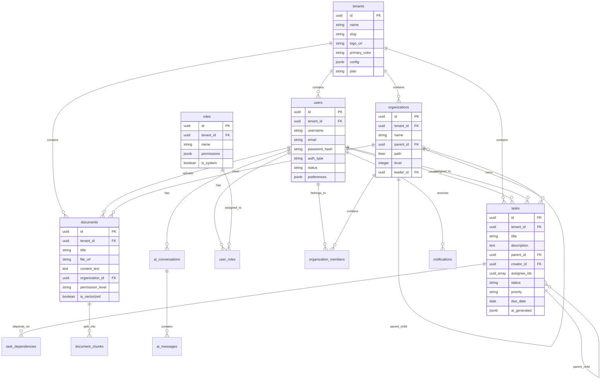

# 数据库 Schema 设计

## 一、设计原则

### 多租户数据隔离
- 所有业务表都包含 `tenant_id` 字段
- 使用 PostgreSQL Row Level Security (RLS) 强制隔离
- 索引策略：所有查询必须包含 `tenant_id`

### 数据完整性
- 使用外键约束保证引用完整性
- 软删除策略：重要数据使用 `deleted_at` 标记
- 审计字段：`created_at`, `updated_at`, `created_by`, `updated_by`

### 性能优化
- 高频查询字段添加索引
- 使用复合索引优化多条件查询
- 大文本字段考虑分表存储

---

## 二、核心表结构

### 1. tenants（租户表）

**用途：** 存储租户（公司）基本信息和配置

```sql
CREATE TABLE tenants (
  id UUID PRIMARY KEY DEFAULT gen_random_uuid(),
  name VARCHAR(255) NOT NULL,                    -- 公司名称
  slug VARCHAR(100) UNIQUE NOT NULL,             -- URL 友好标识（如：acme-corp）
  domain VARCHAR(255) UNIQUE,                    -- 自定义域名（可选）
  
  -- 品牌定制
  logo_url TEXT,                                 -- Logo URL
  primary_color VARCHAR(7) DEFAULT '#1890ff',    -- 主题色
  secondary_color VARCHAR(7) DEFAULT '#52c41a',  -- 辅助色
  
  -- 配置
  config JSONB DEFAULT '{}',                     -- 租户级配置（功能开关、集成配置等）
  
  -- 资源配额
  max_users INTEGER DEFAULT 50,                  -- 最大用户数
  max_storage_gb INTEGER DEFAULT 10,             -- 最大存储空间（GB）
  max_api_calls_per_month INTEGER DEFAULT 100000, -- 每月 API 调用限额
  
  -- 订阅信息
  plan VARCHAR(50) DEFAULT 'free',               -- 套餐：free, basic, pro, enterprise
  subscription_status VARCHAR(50) DEFAULT 'active', -- 订阅状态
  subscription_expires_at TIMESTAMP WITH TIME ZONE,
  
  -- 审计字段
  created_at TIMESTAMP WITH TIME ZONE DEFAULT NOW(),
  updated_at TIMESTAMP WITH TIME ZONE DEFAULT NOW(),
  deleted_at TIMESTAMP WITH TIME ZONE,           -- 软删除
  
  -- 约束
  CONSTRAINT valid_colors CHECK (
    primary_color ~* '^#[0-9A-F]{6}$' AND 
    secondary_color ~* '^#[0-9A-F]{6}$'
  )
);

-- 索引
CREATE INDEX idx_tenants_slug ON tenants(slug) WHERE deleted_at IS NULL;
CREATE INDEX idx_tenants_domain ON tenants(domain) WHERE deleted_at IS NULL;

-- 触发器：自动更新 updated_at
CREATE TRIGGER update_tenants_updated_at
  BEFORE UPDATE ON tenants
  FOR EACH ROW
  EXECUTE FUNCTION update_updated_at_column();
```

**TypeScript 接口：**
```typescript
interface Tenant {
  id: string;
  name: string;
  slug: string;
  domain?: string;
  logoUrl?: string;
  primaryColor: string;
  secondaryColor: string;
  config: Record<string, any>;
  maxUsers: number;
  maxStorageGb: number;
  maxApiCallsPerMonth: number;
  plan: 'free' | 'basic' | 'pro' | 'enterprise';
  subscriptionStatus: 'active' | 'suspended' | 'cancelled';
  subscriptionExpiresAt?: Date;
  createdAt: Date;
  updatedAt: Date;
  deletedAt?: Date;
}
```

---

### 2. users（用户表）

**用途：** 存储用户账号信息

```sql
CREATE TABLE users (
  id UUID PRIMARY KEY DEFAULT gen_random_uuid(),
  tenant_id UUID NOT NULL REFERENCES tenants(id) ON DELETE CASCADE,
  
  -- 基本信息
  username VARCHAR(100) NOT NULL,                -- 用户名
  email VARCHAR(255) NOT NULL,                   -- 邮箱
  phone VARCHAR(50),                             -- 手机号
  full_name VARCHAR(255),                        -- 全名
  avatar_url TEXT,                               -- 头像 URL
  
  -- 认证信息
  password_hash TEXT,                            -- 密码哈希（bcrypt）
  auth_type VARCHAR(50) DEFAULT 'password',      -- 认证类型：password, feishu, wechat, dingtalk
  external_id VARCHAR(255),                      -- 第三方平台用户 ID
  
  -- 状态
  status VARCHAR(50) DEFAULT 'active',           -- active, suspended, inactive
  email_verified BOOLEAN DEFAULT FALSE,
  phone_verified BOOLEAN DEFAULT FALSE,
  
  -- 偏好设置
  preferences JSONB DEFAULT '{}',                -- 用户偏好（AI 设置、通知设置等）
  
  -- 登录信息
  last_login_at TIMESTAMP WITH TIME ZONE,
  last_login_ip INET,
  
  -- 审计字段
  created_at TIMESTAMP WITH TIME ZONE DEFAULT NOW(),
  updated_at TIMESTAMP WITH TIME ZONE DEFAULT NOW(),
  created_by UUID REFERENCES users(id),
  updated_by UUID REFERENCES users(id),
  deleted_at TIMESTAMP WITH TIME ZONE,
  
  -- 约束
  CONSTRAINT unique_tenant_username UNIQUE(tenant_id, username),
  CONSTRAINT unique_tenant_email UNIQUE(tenant_id, email),
  CONSTRAINT valid_auth_type CHECK (auth_type IN ('password', 'feishu', 'wechat', 'dingtalk'))
);

-- 索引
CREATE INDEX idx_users_tenant_id ON users(tenant_id) WHERE deleted_at IS NULL;
CREATE INDEX idx_users_email ON users(email) WHERE deleted_at IS NULL;
CREATE INDEX idx_users_external_id ON users(tenant_id, auth_type, external_id) WHERE deleted_at IS NULL;

-- Row Level Security
ALTER TABLE users ENABLE ROW LEVEL SECURITY;

CREATE POLICY tenant_isolation ON users
  USING (tenant_id = current_setting('app.current_tenant')::UUID);
```

**TypeScript 接口：**
```typescript
interface User {
  id: string;
  tenantId: string;
  username: string;
  email: string;
  phone?: string;
  fullName?: string;
  avatarUrl?: string;
  passwordHash?: string;
  authType: 'password' | 'feishu' | 'wechat' | 'dingtalk';
  externalId?: string;
  status: 'active' | 'suspended' | 'inactive';
  emailVerified: boolean;
  phoneVerified: boolean;
  preferences: {
    ai?: {
      defaultModel?: string;
      temperature?: number;
    };
    notifications?: {
      email?: boolean;
      inApp?: boolean;
    };
  };
  lastLoginAt?: Date;
  lastLoginIp?: string;
  createdAt: Date;
  updatedAt: Date;
  createdBy?: string;
  updatedBy?: string;
  deletedAt?: Date;
}
```

---

### 3. roles（角色表）

**用途：** 定义系统角色

```sql
CREATE TABLE roles (
  id UUID PRIMARY KEY DEFAULT gen_random_uuid(),
  tenant_id UUID NOT NULL REFERENCES tenants(id) ON DELETE CASCADE,
  
  name VARCHAR(100) NOT NULL,                    -- 角色名称：admin, manager, member
  display_name VARCHAR(255) NOT NULL,            -- 显示名称
  description TEXT,                              -- 角色描述
  
  -- 内置角色标记（不可删除）
  is_system BOOLEAN DEFAULT FALSE,
  
  -- 权限列表（JSONB 存储）
  permissions JSONB DEFAULT '[]',                -- [{ resource: 'task', action: 'create', scope: 'team' }]
  
  -- 审计字段
  created_at TIMESTAMP WITH TIME ZONE DEFAULT NOW(),
  updated_at TIMESTAMP WITH TIME ZONE DEFAULT NOW(),
  deleted_at TIMESTAMP WITH TIME ZONE,
  
  -- 约束
  CONSTRAINT unique_tenant_role_name UNIQUE(tenant_id, name)
);

-- 索引
CREATE INDEX idx_roles_tenant_id ON roles(tenant_id) WHERE deleted_at IS NULL;

-- 插入系统默认角色
INSERT INTO roles (tenant_id, name, display_name, is_system, permissions) VALUES
  -- 这些是模板，实际创建租户时会复制
  (NULL, 'admin', '管理员', TRUE, '[
    {"resource": "*", "action": "*", "scope": "all"}
  ]'),
  (NULL, 'manager', '经理', TRUE, '[
    {"resource": "user", "action": "read", "scope": "team"},
    {"resource": "user", "action": "create", "scope": "team"},
    {"resource": "user", "action": "update", "scope": "team"},
    {"resource": "task", "action": "*", "scope": "team"},
    {"resource": "document", "action": "*", "scope": "team"}
  ]'),
  (NULL, 'member', '员工', TRUE, '[
    {"resource": "task", "action": "read", "scope": "own"},
    {"resource": "task", "action": "update", "scope": "own"},
    {"resource": "document", "action": "read", "scope": "team"},
    {"resource": "ai", "action": "*", "scope": "own"}
  ]');
```

**TypeScript 接口：**
```typescript
interface Role {
  id: string;
  tenantId: string;
  name: string;
  displayName: string;
  description?: string;
  isSystem: boolean;
  permissions: Permission[];
  createdAt: Date;
  updatedAt: Date;
  deletedAt?: Date;
}

interface Permission {
  resource: string;  // 'user' | 'task' | 'document' | 'organization' | '*'
  action: string;    // 'create' | 'read' | 'update' | 'delete' | '*'
  scope: string;     // 'own' | 'team' | 'all'
}
```

---

### 4. user_roles（用户角色关联表）

**用途：** 用户与角色的多对多关系

```sql
CREATE TABLE user_roles (
  id UUID PRIMARY KEY DEFAULT gen_random_uuid(),
  tenant_id UUID NOT NULL REFERENCES tenants(id) ON DELETE CASCADE,
  user_id UUID NOT NULL REFERENCES users(id) ON DELETE CASCADE,
  role_id UUID NOT NULL REFERENCES roles(id) ON DELETE CASCADE,
  
  -- 审计字段
  created_at TIMESTAMP WITH TIME ZONE DEFAULT NOW(),
  created_by UUID REFERENCES users(id),
  
  -- 约束
  CONSTRAINT unique_user_role UNIQUE(tenant_id, user_id, role_id)
);

-- 索引
CREATE INDEX idx_user_roles_user_id ON user_roles(user_id);
CREATE INDEX idx_user_roles_role_id ON user_roles(role_id);
CREATE INDEX idx_user_roles_tenant_id ON user_roles(tenant_id);
```

---

### 5. organizations（组织架构表）

**用途：** 存储部门/团队层级结构

```sql
CREATE TABLE organizations (
  id UUID PRIMARY KEY DEFAULT gen_random_uuid(),
  tenant_id UUID NOT NULL REFERENCES tenants(id) ON DELETE CASCADE,
  
  -- 基本信息
  name VARCHAR(255) NOT NULL,                    -- 部门名称
  code VARCHAR(100),                             -- 部门编码（可选）
  description TEXT,                              -- 部门描述
  
  -- 层级关系（使用 ltree 扩展支持树形查询）
  parent_id UUID REFERENCES organizations(id) ON DELETE CASCADE,
  path LTREE,                                    -- 路径：root.sales.east
  level INTEGER DEFAULT 0,                       -- 层级：0=公司，1=一级部门，2=二级部门...
  
  -- 负责人
  leader_id UUID REFERENCES users(id) ON DELETE SET NULL,
  
  -- 类型
  type VARCHAR(50) DEFAULT 'department',         -- company, department, team
  
  -- 排序
  sort_order INTEGER DEFAULT 0,
  
  -- 审计字段
  created_at TIMESTAMP WITH TIME ZONE DEFAULT NOW(),
  updated_at TIMESTAMP WITH TIME ZONE DEFAULT NOW(),
  created_by UUID REFERENCES users(id),
  updated_by UUID REFERENCES users(id),
  deleted_at TIMESTAMP WITH TIME ZONE,
  
  -- 约束
  CONSTRAINT valid_type CHECK (type IN ('company', 'department', 'team'))
);

-- 索引
CREATE INDEX idx_organizations_tenant_id ON organizations(tenant_id) WHERE deleted_at IS NULL;
CREATE INDEX idx_organizations_parent_id ON organizations(parent_id) WHERE deleted_at IS NULL;
CREATE INDEX idx_organizations_path ON organizations USING GIST(path) WHERE deleted_at IS NULL;
CREATE INDEX idx_organizations_leader_id ON organizations(leader_id) WHERE deleted_at IS NULL;

-- 触发器：自动计算 path 和 level
CREATE OR REPLACE FUNCTION update_organization_path()
RETURNS TRIGGER AS $$
BEGIN
  IF NEW.parent_id IS NULL THEN
    -- 根节点
    NEW.path = NEW.id::TEXT::LTREE;
    NEW.level = 0;
  ELSE
    -- 子节点：继承父节点 path
    SELECT path || NEW.id::TEXT::LTREE, level + 1
    INTO NEW.path, NEW.level
    FROM organizations
    WHERE id = NEW.parent_id;
  END IF;
  RETURN NEW;
END;
$$ LANGUAGE plpgsql;

CREATE TRIGGER set_organization_path
  BEFORE INSERT OR UPDATE OF parent_id ON organizations
  FOR EACH ROW
  EXECUTE FUNCTION update_organization_path();
```

**TypeScript 接口：**
```typescript
interface Organization {
  id: string;
  tenantId: string;
  name: string;
  code?: string;
  description?: string;
  parentId?: string;
  path: string;      // ltree 路径
  level: number;
  leaderId?: string;
  type: 'company' | 'department' | 'team';
  sortOrder: number;
  createdAt: Date;
  updatedAt: Date;
  createdBy?: string;
  updatedBy?: string;
  deletedAt?: Date;
}
```

---

### 6. organization_members（组织成员关联表）

**用途：** 用户与部门的多对多关系（支持跨部门）

```sql
CREATE TABLE organization_members (
  id UUID PRIMARY KEY DEFAULT gen_random_uuid(),
  tenant_id UUID NOT NULL REFERENCES tenants(id) ON DELETE CASCADE,
  organization_id UUID NOT NULL REFERENCES organizations(id) ON DELETE CASCADE,
  user_id UUID NOT NULL REFERENCES users(id) ON DELETE CASCADE,
  
  -- 是否主部门
  is_primary BOOLEAN DEFAULT TRUE,
  
  -- 职位
  position VARCHAR(255),                         -- 职位名称（如：销售经理、前端工程师）
  
  -- 审计字段
  created_at TIMESTAMP WITH TIME ZONE DEFAULT NOW(),
  created_by UUID REFERENCES users(id),
  
  -- 约束
  CONSTRAINT unique_org_user UNIQUE(tenant_id, organization_id, user_id)
);

-- 索引
CREATE INDEX idx_org_members_org_id ON organization_members(organization_id);
CREATE INDEX idx_org_members_user_id ON organization_members(user_id);
CREATE INDEX idx_org_members_tenant_id ON organization_members(tenant_id);

-- 确保每个用户只有一个主部门
CREATE UNIQUE INDEX idx_org_members_primary 
  ON organization_members(tenant_id, user_id) 
  WHERE is_primary = TRUE;
```

---

### 7. tasks（任务表）

**用途：** 存储任务信息

```sql
CREATE TABLE tasks (
  id UUID PRIMARY KEY DEFAULT gen_random_uuid(),
  tenant_id UUID NOT NULL REFERENCES tenants(id) ON DELETE CASCADE,
  
  -- 基本信息
  title VARCHAR(500) NOT NULL,                   -- 任务标题
  description TEXT,                              -- 任务描述
  
  -- 关联
  parent_id UUID REFERENCES tasks(id) ON DELETE CASCADE, -- 父任务（子任务关系）
  organization_id UUID REFERENCES organizations(id), -- 所属部门
  
  -- 创建者和负责人
  creator_id UUID NOT NULL REFERENCES users(id),
  assignee_ids UUID[] DEFAULT '{}',              -- 负责人列表（支持多人）
  
  -- 状态和优先级
  status VARCHAR(50) DEFAULT 'todo',             -- todo, in_progress, review, done, cancelled
  priority VARCHAR(50) DEFAULT 'medium',         -- low, medium, high, urgent
  
  -- 时间
  start_date DATE,
  due_date DATE,
  completed_at TIMESTAMP WITH TIME ZONE,
  
  -- 标签和分类
  tags TEXT[] DEFAULT '{}',                      -- 标签数组
  category VARCHAR(100),                         -- 分类
  
  -- AI 生成标记
  ai_generated JSONB DEFAULT '{}',               -- { autoExpanded: true, suggestedAssignees: [...] }
  
  -- 附件和关联
  attachment_ids UUID[] DEFAULT '{}',            -- 附件 ID 列表
  related_task_ids UUID[] DEFAULT '{}',          -- 关联任务 ID 列表
  
  -- 审计字段
  created_at TIMESTAMP WITH TIME ZONE DEFAULT NOW(),
  updated_at TIMESTAMP WITH TIME ZONE DEFAULT NOW(),
  created_by UUID REFERENCES users(id),
  updated_by UUID REFERENCES users(id),
  deleted_at TIMESTAMP WITH TIME ZONE,
  
  -- 约束
  CONSTRAINT valid_status CHECK (status IN ('todo', 'in_progress', 'review', 'done', 'cancelled')),
  CONSTRAINT valid_priority CHECK (priority IN ('low', 'medium', 'high', 'urgent'))
);

-- 索引
CREATE INDEX idx_tasks_tenant_id ON tasks(tenant_id) WHERE deleted_at IS NULL;
CREATE INDEX idx_tasks_creator_id ON tasks(creator_id) WHERE deleted_at IS NULL;
CREATE INDEX idx_tasks_assignee_ids ON tasks USING GIN(assignee_ids) WHERE deleted_at IS NULL;
CREATE INDEX idx_tasks_organization_id ON tasks(organization_id) WHERE deleted_at IS NULL;
CREATE INDEX idx_tasks_parent_id ON tasks(parent_id) WHERE deleted_at IS NULL;
CREATE INDEX idx_tasks_status ON tasks(status) WHERE deleted_at IS NULL;
CREATE INDEX idx_tasks_due_date ON tasks(due_date) WHERE deleted_at IS NULL AND status != 'done';
CREATE INDEX idx_tasks_tags ON tasks USING GIN(tags) WHERE deleted_at IS NULL;
```

**TypeScript 接口：**
```typescript
interface Task {
  id: string;
  tenantId: string;
  title: string;
  description?: string;
  parentId?: string;
  organizationId?: string;
  creatorId: string;
  assigneeIds: string[];
  status: 'todo' | 'in_progress' | 'review' | 'done' | 'cancelled';
  priority: 'low' | 'medium' | 'high' | 'urgent';
  startDate?: Date;
  dueDate?: Date;
  completedAt?: Date;
  tags: string[];
  category?: string;
  aiGenerated: {
    autoExpanded?: boolean;
    suggestedAssignees?: string[];
  };
  attachmentIds: string[];
  relatedTaskIds: string[];
  createdAt: Date;
  updatedAt: Date;
  createdBy?: string;
  updatedBy?: string;
  deletedAt?: Date;
}
```

---

### 8. task_dependencies（任务依赖关系表）

**用途：** 任务之间的依赖关系

```sql
CREATE TABLE task_dependencies (
  id UUID PRIMARY KEY DEFAULT gen_random_uuid(),
  tenant_id UUID NOT NULL REFERENCES tenants(id) ON DELETE CASCADE,
  
  task_id UUID NOT NULL REFERENCES tasks(id) ON DELETE CASCADE,        -- 当前任务
  depends_on_task_id UUID NOT NULL REFERENCES tasks(id) ON DELETE CASCADE, -- 依赖的任务
  
  dependency_type VARCHAR(50) DEFAULT 'finish_to_start', -- 依赖类型
  
  created_at TIMESTAMP WITH TIME ZONE DEFAULT NOW(),
  created_by UUID REFERENCES users(id),
  
  -- 约束：防止循环依赖和重复依赖
  CONSTRAINT unique_task_dependency UNIQUE(tenant_id, task_id, depends_on_task_id),
  CONSTRAINT no_self_dependency CHECK (task_id != depends_on_task_id),
  CONSTRAINT valid_dependency_type CHECK (dependency_type IN ('finish_to_start', 'start_to_start', 'finish_to_finish'))
);

-- 索引
CREATE INDEX idx_task_deps_task_id ON task_dependencies(task_id);
CREATE INDEX idx_task_deps_depends_on ON task_dependencies(depends_on_task_id);
```

---

### 9. documents（文档表）

**用途：** 存储知识库文档信息

```sql
CREATE TABLE documents (
  id UUID PRIMARY KEY DEFAULT gen_random_uuid(),
  tenant_id UUID NOT NULL REFERENCES tenants(id) ON DELETE CASCADE,
  
  -- 基本信息
  title VARCHAR(500) NOT NULL,
  file_name VARCHAR(255) NOT NULL,
  file_type VARCHAR(50) NOT NULL,                -- pdf, docx, md, txt
  file_size BIGINT NOT NULL,                     -- 文件大小（字节）
  file_url TEXT NOT NULL,                        -- 文件存储 URL（S3/MinIO）
  
  -- 内容
  content_text TEXT,                             -- 提取的纯文本内容
  
  -- 分类和标签
  organization_id UUID REFERENCES organizations(id), -- 所属部门
  category VARCHAR(100),
  tags TEXT[] DEFAULT '{}',
  
  -- 权限
  permission_level VARCHAR(50) DEFAULT 'public', -- public, department, private
  allowed_user_ids UUID[] DEFAULT '{}',          -- 私有文档的授权用户列表
  
  -- 向量化状态
  is_vectorized BOOLEAN DEFAULT FALSE,
  vectorized_at TIMESTAMP WITH TIME ZONE,
  vector_count INTEGER DEFAULT 0,                -- 分块数量
  
  -- 上传者
  uploaded_by UUID NOT NULL REFERENCES users(id),
  
  -- 审计字段
  created_at TIMESTAMP WITH TIME ZONE DEFAULT NOW(),
  updated_at TIMESTAMP WITH TIME ZONE DEFAULT NOW(),
  deleted_at TIMESTAMP WITH TIME ZONE,
  
  -- 约束
  CONSTRAINT valid_permission_level CHECK (permission_level IN ('public', 'department', 'private'))
);

-- 索引
CREATE INDEX idx_documents_tenant_id ON documents(tenant_id) WHERE deleted_at IS NULL;
CREATE INDEX idx_documents_organization_id ON documents(organization_id) WHERE deleted_at IS NULL;
CREATE INDEX idx_documents_uploaded_by ON documents(uploaded_by) WHERE deleted_at IS NULL;
CREATE INDEX idx_documents_tags ON documents USING GIN(tags) WHERE deleted_at IS NULL;
CREATE INDEX idx_documents_is_vectorized ON documents(is_vectorized) WHERE deleted_at IS NULL;
```

**TypeScript 接口：**
```typescript
interface Document {
  id: string;
  tenantId: string;
  title: string;
  fileName: string;
  fileType: string;
  fileSize: number;
  fileUrl: string;
  contentText?: string;
  organizationId?: string;
  category?: string;
  tags: string[];
  permissionLevel: 'public' | 'department' | 'private';
  allowedUserIds: string[];
  isVectorized: boolean;
  vectorizedAt?: Date;
  vectorCount: number;
  uploadedBy: string;
  createdAt: Date;
  updatedAt: Date;
  deletedAt?: Date;
}
```

---

### 10. document_chunks（文档分块表）

**用途：** 存储文档向量化后的分块信息

```sql
CREATE TABLE document_chunks (
  id UUID PRIMARY KEY DEFAULT gen_random_uuid(),
  tenant_id UUID NOT NULL REFERENCES tenants(id) ON DELETE CASCADE,
  document_id UUID NOT NULL REFERENCES documents(id) ON DELETE CASCADE,
  
  -- 分块信息
  chunk_index INTEGER NOT NULL,                  -- 分块序号
  content TEXT NOT NULL,                         -- 分块文本内容
  token_count INTEGER,                           -- Token 数量
  
  -- 位置信息
  page_number INTEGER,                           -- 页码（PDF）
  section VARCHAR(500),                          -- 章节标题
  
  -- 向量 ID（存储在向量数据库中的 ID）
  vector_id VARCHAR(255),
  
  -- 审计字段
  created_at TIMESTAMP WITH TIME ZONE DEFAULT NOW(),
  
  -- 约束
  CONSTRAINT unique_document_chunk UNIQUE(document_id, chunk_index)
);

-- 索引
CREATE INDEX idx_doc_chunks_document_id ON document_chunks(document_id);
CREATE INDEX idx_doc_chunks_vector_id ON document_chunks(vector_id);
```

---

### 11. notifications（通知表）

**用途：** 存储系统通知

```sql
CREATE TABLE notifications (
  id UUID PRIMARY KEY DEFAULT gen_random_uuid(),
  tenant_id UUID NOT NULL REFERENCES tenants(id) ON DELETE CASCADE,
  
  -- 接收者
  user_id UUID NOT NULL REFERENCES users(id) ON DELETE CASCADE,
  
  -- 通知内容
  type VARCHAR(100) NOT NULL,                    -- task_assigned, task_completed, task_due_soon
  title VARCHAR(255) NOT NULL,
  content TEXT,
  
  -- 关联对象
  related_type VARCHAR(100),                     -- task, document, user
  related_id UUID,
  
  -- 状态
  is_read BOOLEAN DEFAULT FALSE,
  read_at TIMESTAMP WITH TIME ZONE,
  
  -- 审计字段
  created_at TIMESTAMP WITH TIME ZONE DEFAULT NOW(),
  
  -- 约束
  CONSTRAINT valid_notification_type CHECK (type IN (
    'task_assigned', 'task_completed', 'task_due_soon', 
    'task_status_changed', 'document_shared', 'mention'
  ))
);

-- 索引
CREATE INDEX idx_notifications_user_id ON notifications(user_id, is_read, created_at DESC);
CREATE INDEX idx_notifications_tenant_id ON notifications(tenant_id);

-- 自动清理 30 天前的已读通知
CREATE INDEX idx_notifications_cleanup ON notifications(created_at) WHERE is_read = TRUE;
```

**TypeScript 接口：**
```typescript
interface Notification {
  id: string;
  tenantId: string;
  userId: string;
  type: 'task_assigned' | 'task_completed' | 'task_due_soon' | 'task_status_changed' | 'document_shared' | 'mention';
  title: string;
  content?: string;
  relatedType?: 'task' | 'document' | 'user';
  relatedId?: string;
  isRead: boolean;
  readAt?: Date;
  createdAt: Date;
}
```

---

### 12. ai_conversations（AI 对话历史表）

**用途：** 存储用户与 AI 的对话历史

```sql
CREATE TABLE ai_conversations (
  id UUID PRIMARY KEY DEFAULT gen_random_uuid(),
  tenant_id UUID NOT NULL REFERENCES tenants(id) ON DELETE CASCADE,
  
  -- 用户
  user_id UUID NOT NULL REFERENCES users(id) ON DELETE CASCADE,
  
  -- 对话信息
  title VARCHAR(255),                            -- 对话标题（从第一条消息生成）
  
  -- 关联上下文
  context_type VARCHAR(100),                     -- task, document, general
  context_id UUID,                               -- 关联的任务/文档 ID
  
  -- 对话摘要
  message_count INTEGER DEFAULT 0,
  last_message_at TIMESTAMP WITH TIME ZONE,
  
  -- 审计字段
  created_at TIMESTAMP WITH TIME ZONE DEFAULT NOW(),
  updated_at TIMESTAMP WITH TIME ZONE DEFAULT NOW(),
  deleted_at TIMESTAMP WITH TIME ZONE
);

-- 索引
CREATE INDEX idx_ai_convs_user_id ON ai_conversations(user_id) WHERE deleted_at IS NULL;
CREATE INDEX idx_ai_convs_tenant_id ON ai_conversations(tenant_id) WHERE deleted_at IS NULL;
CREATE INDEX idx_ai_convs_context ON ai_conversations(context_type, context_id) WHERE deleted_at IS NULL;
```

---

### 13. ai_messages（AI 消息表）

**用途：** 存储对话中的具体消息

```sql
CREATE TABLE ai_messages (
  id UUID PRIMARY KEY DEFAULT gen_random_uuid(),
  tenant_id UUID NOT NULL REFERENCES tenants(id) ON DELETE CASCADE,
  conversation_id UUID NOT NULL REFERENCES ai_conversations(id) ON DELETE CASCADE,
  
  -- 消息内容
  role VARCHAR(50) NOT NULL,                     -- user, assistant, system
  content TEXT NOT NULL,
  
  -- 元数据
  metadata JSONB DEFAULT '{}',                   -- 模型、token 数、引用来源等
  
  -- 审计字段
  created_at TIMESTAMP WITH TIME ZONE DEFAULT NOW(),
  
  -- 约束
  CONSTRAINT valid_role CHECK (role IN ('user', 'assistant', 'system'))
);

-- 索引
CREATE INDEX idx_ai_messages_conv_id ON ai_messages(conversation_id, created_at);
CREATE INDEX idx_ai_messages_tenant_id ON ai_messages(tenant_id);
```

**TypeScript 接口：**
```typescript
interface AIConversation {
  id: string;
  tenantId: string;
  userId: string;
  title?: string;
  contextType?: 'task' | 'document' | 'general';
  contextId?: string;
  messageCount: number;
  lastMessageAt?: Date;
  createdAt: Date;
  updatedAt: Date;
  deletedAt?: Date;
}

interface AIMessage {
  id: string;
  tenantId: string;
  conversationId: string;
  role: 'user' | 'assistant' | 'system';
  content: string;
  metadata: {
    model?: string;
    inputTokens?: number;
    outputTokens?: number;
    sources?: Array<{ documentId: string; chunkIndex: number }>;
  };
  createdAt: Date;
}
```

---

### 14. attachments（附件表）

**用途：** 存储任务附件信息

```sql
CREATE TABLE attachments (
  id UUID PRIMARY KEY DEFAULT gen_random_uuid(),
  tenant_id UUID NOT NULL REFERENCES tenants(id) ON DELETE CASCADE,
  
  -- 关联对象
  related_type VARCHAR(100) NOT NULL,            -- task, document, message
  related_id UUID NOT NULL,
  
  -- 文件信息
  file_name VARCHAR(255) NOT NULL,
  file_type VARCHAR(100) NOT NULL,
  file_size BIGINT NOT NULL,
  file_url TEXT NOT NULL,                        -- 存储 URL
  
  -- 上传者
  uploaded_by UUID NOT NULL REFERENCES users(id),
  
  -- 审计字段
  created_at TIMESTAMP WITH TIME ZONE DEFAULT NOW(),
  deleted_at TIMESTAMP WITH TIME ZONE
);

-- 索引
CREATE INDEX idx_attachments_related ON attachments(related_type, related_id) WHERE deleted_at IS NULL;
CREATE INDEX idx_attachments_tenant_id ON attachments(tenant_id) WHERE deleted_at IS NULL;
```

---

### 15. audit_logs（审计日志表）

**用途：** 记录关键操作的审计日志

```sql
CREATE TABLE audit_logs (
  id UUID PRIMARY KEY DEFAULT gen_random_uuid(),
  tenant_id UUID NOT NULL REFERENCES tenants(id) ON DELETE CASCADE,
  
  -- 操作者
  user_id UUID REFERENCES users(id) ON DELETE SET NULL,
  user_email VARCHAR(255),                       -- 冗余存储，防止用户删除后无法追溯
  
  -- 操作信息
  action VARCHAR(100) NOT NULL,                  -- create, update, delete, login, logout
  resource_type VARCHAR(100) NOT NULL,           -- user, task, document, organization
  resource_id UUID,
  
  -- 详情
  details JSONB DEFAULT '{}',                    -- 操作详情（变更前后的值）
  
  -- 请求信息
  ip_address INET,
  user_agent TEXT,
  
  -- 时间
  created_at TIMESTAMP WITH TIME ZONE DEFAULT NOW()
);

-- 索引
CREATE INDEX idx_audit_logs_tenant_id ON audit_logs(tenant_id, created_at DESC);
CREATE INDEX idx_audit_logs_user_id ON audit_logs(user_id, created_at DESC);
CREATE INDEX idx_audit_logs_resource ON audit_logs(resource_type, resource_id, created_at DESC);

-- 分区策略：按月分区（提高查询性能）
-- CREATE TABLE audit_logs_y2026m10 PARTITION OF audit_logs
--   FOR VALUES FROM ('2026-10-01') TO ('2026-11-01');
```

**TypeScript 接口：**
```typescript
interface AuditLog {
  id: string;
  tenantId: string;
  userId?: string;
  userEmail?: string;
  action: 'create' | 'update' | 'delete' | 'login' | 'logout';
  resourceType: 'user' | 'task' | 'document' | 'organization';
  resourceId?: string;
  details: Record<string, any>;
  ipAddress?: string;
  userAgent?: string;
  createdAt: Date;
}
```

---

## 三、辅助函数和触发器

### 1. 自动更新 updated_at 函数

```sql
CREATE OR REPLACE FUNCTION update_updated_at_column()
RETURNS TRIGGER AS $$
BEGIN
  NEW.updated_at = NOW();
  RETURN NEW;
END;
$$ LANGUAGE plpgsql;

-- 应用到所有需要的表
CREATE TRIGGER update_users_updated_at
  BEFORE UPDATE ON users
  FOR EACH ROW
  EXECUTE FUNCTION update_updated_at_column();

CREATE TRIGGER update_organizations_updated_at
  BEFORE UPDATE ON organizations
  FOR EACH ROW
  EXECUTE FUNCTION update_updated_at_column();

CREATE TRIGGER update_tasks_updated_at
  BEFORE UPDATE ON tasks
  FOR EACH ROW
  EXECUTE FUNCTION update_updated_at_column();

CREATE TRIGGER update_documents_updated_at
  BEFORE UPDATE ON documents
  FOR EACH ROW
  EXECUTE FUNCTION update_updated_at_column();
```

---

### 2. 租户上下文设置函数

```sql
-- 设置当前租户上下文（用于 Row Level Security）
CREATE OR REPLACE FUNCTION set_tenant_context(tenant_uuid UUID)
RETURNS VOID AS $$
BEGIN
  PERFORM set_config('app.current_tenant', tenant_uuid::TEXT, FALSE);
END;
$$ LANGUAGE plpgsql;

-- 获取当前租户上下文
CREATE OR REPLACE FUNCTION get_current_tenant()
RETURNS UUID AS $$
BEGIN
  RETURN current_setting('app.current_tenant', TRUE)::UUID;
EXCEPTION
  WHEN OTHERS THEN
    RETURN NULL;
END;
$$ LANGUAGE plpgsql;
```

---

### 3. 任务统计触发器

```sql
-- 子任务完成时检查父任务是否全部完成
CREATE OR REPLACE FUNCTION check_parent_task_completion()
RETURNS TRIGGER AS $$
DECLARE
  all_subtasks_done BOOLEAN;
BEGIN
  IF NEW.status = 'done' AND NEW.parent_id IS NOT NULL THEN
    -- 检查所有子任务是否都完成
    SELECT NOT EXISTS (
      SELECT 1 FROM tasks
      WHERE parent_id = NEW.parent_id
        AND status != 'done'
        AND deleted_at IS NULL
    ) INTO all_subtasks_done;
    
    IF all_subtasks_done THEN
      -- 自动完成父任务
      UPDATE tasks
      SET status = 'done', completed_at = NOW()
      WHERE id = NEW.parent_id;
    END IF;
  END IF;
  
  RETURN NEW;
END;
$$ LANGUAGE plpgsql;

CREATE TRIGGER auto_complete_parent_task
  AFTER UPDATE OF status ON tasks
  FOR EACH ROW
  WHEN (NEW.status = 'done' AND NEW.parent_id IS NOT NULL)
  EXECUTE FUNCTION check_parent_task_completion();
```

---

### 4. 通知创建触发器

```sql
-- 任务分配时自动创建通知
CREATE OR REPLACE FUNCTION notify_task_assigned()
RETURNS TRIGGER AS $$
BEGIN
  -- 为每个负责人创建通知
  IF NEW.assignee_ids IS NOT NULL THEN
    INSERT INTO notifications (tenant_id, user_id, type, title, content, related_type, related_id)
    SELECT 
      NEW.tenant_id,
      unnest(NEW.assignee_ids),
      'task_assigned',
      '新任务分配给您',
      '任务：' || NEW.title,
      'task',
      NEW.id;
  END IF;
  
  RETURN NEW;
END;
$$ LANGUAGE plpgsql;

CREATE TRIGGER create_task_assigned_notification
  AFTER INSERT ON tasks
  FOR EACH ROW
  WHEN (NEW.assignee_ids IS NOT NULL AND array_length(NEW.assignee_ids, 1) > 0)
  EXECUTE FUNCTION notify_task_assigned();
```

---

## 四、数据库初始化脚本

### 完整的迁移脚本

```sql
-- 01_extensions.sql
-- 启用必需的 PostgreSQL 扩展
CREATE EXTENSION IF NOT EXISTS "uuid-ossp";
CREATE EXTENSION IF NOT EXISTS "pgcrypto";
CREATE EXTENSION IF NOT EXISTS "ltree";

-- 02_base_tables.sql
-- 创建基础表（按依赖顺序）
-- 1. tenants
-- 2. users
-- 3. roles
-- 4. user_roles
-- 5. organizations
-- 6. organization_members

-- 03_business_tables.sql
-- 创建业务表
-- 7. tasks
-- 8. task_dependencies
-- 9. documents
-- 10. document_chunks
-- 11. notifications
-- 12. ai_conversations
-- 13. ai_messages
-- 14. attachments
-- 15. audit_logs

-- 04_functions_triggers.sql
-- 创建函数和触发器

-- 05_rls_policies.sql
-- 启用 Row Level Security

-- 06_seed_data.sql
-- 插入初始数据（系统角色模板等）
```

---

## 五、ER 图（Mermaid 格式）



---

## 六、索引策略总结

### 高频查询优化

**1. 用户登录查询**
```sql
-- 查询：SELECT * FROM users WHERE tenant_id = ? AND email = ?
CREATE INDEX idx_users_tenant_email ON users(tenant_id, email) WHERE deleted_at IS NULL;
```

**2. 任务列表查询**
```sql
-- 查询：SELECT * FROM tasks WHERE tenant_id = ? AND status = ? ORDER BY due_date
CREATE INDEX idx_tasks_tenant_status_due 
  ON tasks(tenant_id, status, due_date) 
  WHERE deleted_at IS NULL;
```

**3. 组织架构树查询**
```sql
-- 查询：SELECT * FROM organizations WHERE path <@ 'root.sales'
CREATE INDEX idx_organizations_path 
  ON organizations USING GIST(path) 
  WHERE deleted_at IS NULL;
```

**4. 知识库权限查询**
```sql
-- 查询：SELECT * FROM documents WHERE tenant_id = ? AND organization_id IN (...)
CREATE INDEX idx_documents_tenant_org 
  ON documents(tenant_id, organization_id) 
  WHERE deleted_at IS NULL;
```

---

## 七、数据迁移和版本管理

### 使用工具
- **推荐：** [node-pg-migrate](https://github.com/salsita/node-pg-migrate)
- **备选：** Flyway, Liquibase

### 迁移文件命名
```
migrations/
  001_create_base_tables.sql
  002_create_business_tables.sql
  003_create_functions_triggers.sql
  004_enable_rls.sql
  005_seed_initial_data.sql
```

### Schema 版本管理
```sql
CREATE TABLE schema_migrations (
  version INTEGER PRIMARY KEY,
  name VARCHAR(255) NOT NULL,
  applied_at TIMESTAMP WITH TIME ZONE DEFAULT NOW()
);
```

---

## 八、数据备份和恢复策略

### 备份策略
1. **全量备份：** 每天凌晨 2:00
2. **增量备份：** 每 6 小时一次
3. **WAL 归档：** 实时归档事务日志
4. **保留策略：** 全量备份保留 30 天，增量备份保留 7 天

### 备份脚本
```bash
#!/bin/bash
# backup.sh
pg_dump -h localhost -U postgres -d dsh_enterprise \
  --format=custom \
  --file=/backups/dsh_$(date +%Y%m%d_%H%M%S).dump

# 上传到 S3
aws s3 cp /backups/dsh_$(date +%Y%m%d_%H%M%S).dump \
  s3://dsh-backups/postgres/
```

---

## 九、性能监控

### 关键指标
- **连接数：** 监控活跃连接和空闲连接
- **查询性能：** 慢查询日志（> 1 秒）
- **索引使用率：** 未使用的索引、缺失的索引
- **表膨胀率：** 定期 VACUUM ANALYZE

### 监控查询
```sql
-- 查看慢查询
SELECT 
  query,
  calls,
  mean_exec_time,
  max_exec_time
FROM pg_stat_statements
WHERE mean_exec_time > 1000
ORDER BY mean_exec_time DESC
LIMIT 20;

-- 查看未使用的索引
SELECT 
  schemaname,
  tablename,
  indexname,
  idx_scan
FROM pg_stat_user_indexes
WHERE idx_scan = 0
  AND indexname NOT LIKE '%_pkey';
```

---

## 十、总结

### 表结构清单
| 表名 | 用途 | 关键索引 | RLS |
|-----|------|---------|-----|
| tenants | 租户 | slug, domain | ❌ |
| users | 用户 | tenant_id, email | ✅ |
| roles | 角色 | tenant_id, name | ✅ |
| user_roles | 用户角色关联 | user_id, role_id | ✅ |
| organizations | 组织架构 | tenant_id, path, parent_id | ✅ |
| organization_members | 组织成员 | org_id, user_id | ✅ |
| tasks | 任务 | tenant_id, assignee_ids, status | ✅ |
| task_dependencies | 任务依赖 | task_id, depends_on | ✅ |
| documents | 文档 | tenant_id, org_id, tags | ✅ |
| document_chunks | 文档分块 | document_id, vector_id | ✅ |
| notifications | 通知 | user_id, is_read | ✅ |
| ai_conversations | AI 对话 | user_id, context | ✅ |
| ai_messages | AI 消息 | conversation_id | ✅ |
| attachments | 附件 | related_type, related_id | ✅ |
| audit_logs | 审计日志 | tenant_id, user_id, created_at | ✅ |

### 估算存储需求（单租户 100 用户）
- **users:** ~100 行 × 2KB = 200KB
- **tasks:** ~10,000 行 × 5KB = 50MB
- **documents:** ~1,000 行 × 3KB = 3MB
- **document_chunks:** ~50,000 行 × 1KB = 50MB
- **ai_messages:** ~100,000 行 × 2KB = 200MB
- **audit_logs:** ~1,000,000 行 × 1KB = 1GB

**总计：** 约 1.3GB / 租户 / 年

---

**下一步：**
→ 开始 Task #12：搭建基础插件骨架代码

